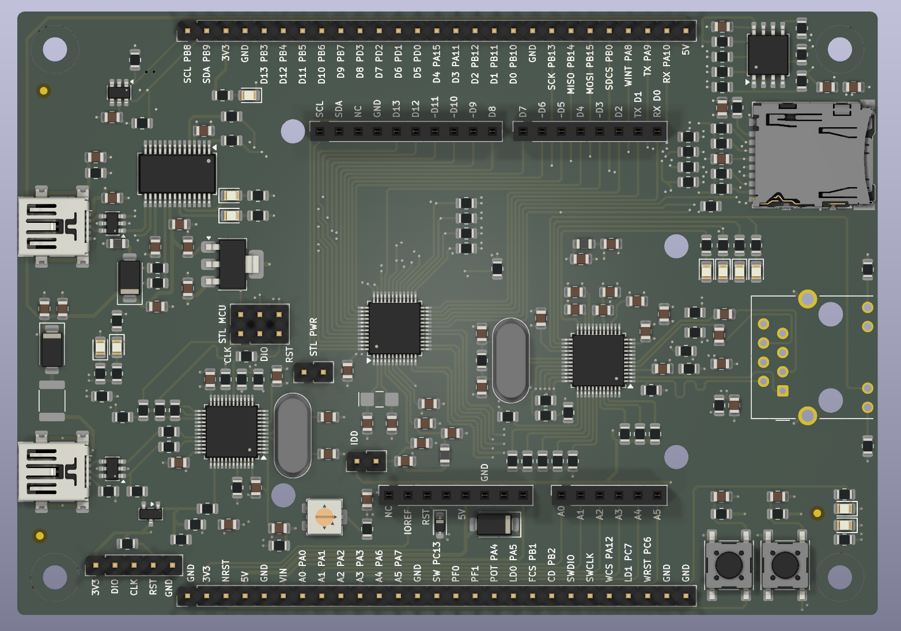

<h1 align="center">g0_dev_board</h1>

  Открытая отладочная плата на STM32G0 для разработки
  <a href="https://github.com/khosta77/stm32-sdk">stm32-sdk</a>
  (C++20, только CMSIS, без HAL).

  
  
  

> **Прототип.** Плата ещё не изготавливалась и не проверялась в железе.
> Проект прошёл ERC и DRC, но перед заказом сверьте стек слоёв и ограничения
> выбранного завода (см. раздел «Производство»).

  

## Назначение

Плата для обкатки драйверов и методологии SDK на STM32G0. Расширения
подключаются через шилды Arduino Uno R3 (CNC Shield V3, модули GSM/Wi-Fi),
все сигналы МК выведены на две гребёнки для логического анализатора.

- Встроенный программатор ST-LINK/V2-1-совместимый (DAPLink или Black Magic Probe)
- USB-UART на USART1, через него же работает ROM-загрузчик STM32G0
- Ethernet 10/100 на W5500, флэш 32 Мбит и microSD на общей шине SPI2
- Два датчика температуры TMP100: на верхней и нижней стороне платы
- Перемычки как на Nucleo: измерение тока МК (JP_IDD), отключение программатора

## Основные характеристики

| Параметр | Значение |
| --- | --- |
| МК | STM32G0B1CCT6 (LQFP-48), pin-to-pin совместим с STM32G071CBT6 |
| Программатор | STM32F103CBT6, USB Mini-B (J201), SWD на МК через JP_SWD 2x3 |
| USB-UART | FT232RL, USB Mini-B (J301) |
| Ethernet | W5500 + RJ45 HR911105A (магнитика в разъёме) |
| Память | W25Q32JVSSIQ (4 МБ) + microSD (Hirose DM3AT), общая SPI2 |
| Датчики | 2x TMP100 на I2C1 (0x4E, 0x4A) |
| Питание | от любого из двух USB через диоды Шоттки, LDO AP7361C-33E на 3.3 В |
| Расширение | разъёмы Arduino Uno R3 (без ICSP), 2 гребёнки ЛА 1x27 |
| Плата | 80 x 114 мм, 4 слоя: сигнал / GND / GND / сигнал |

Полная таблица назначения выводов МК — на листе `scheme/cpu.kicad_sch`
(и в [PDF схемы](docs/schematic.pdf)). Подписи выводов гребёнок ЛА нанесены
на шелкографию в формате «сигнал + порт МК».

## Содержимое репозитория

- `g0_dev_board.kicad_pro`, `g0_dev_board.kicad_sch`, `scheme/` — схема
  (KiCad 10, 8 листов)
- `g0_dev_board.kicad_pcb`, `g0_dev_board.kicad_dru` — плата и
  дополнительные правила DRC
- `g0_dev_board.kicad_sym`, `g0_dev_board.pretty/` — проектные библиотеки
- [`manufacturing/`](manufacturing/) — Gerber, сверловка, BOM и CPL в формате JLCPCB
- [`docs/`](docs/) — [PDF схемы](docs/schematic.pdf) и рендеры платы
- [`scripts/export_manufacturing.py`](scripts/export_manufacturing.py) —
  генерация всех выгрузок одной командой
- [`RULES.md`](RULES.md) — правила расстановки и трассировки платы
- [`CLAUDE.md`](CLAUDE.md) — состав, соглашения проекта, нюансы для прошивки

## Производство

Файлы в `manufacturing/` подготовлены под JLCPCB и подходят большинству
заводов:

- `gerber/` — медь F/In1/In2/B, маска, паста, шелкография, контур,
  сверловка PTH/NPTH (Excellon) с картами отверстий;
- `BOM-g0_dev_board.csv` — колонки `Comment, Designator, Footprint, LCSC Part #`;
- `CPL-g0_dev_board.csv` — колонки `Designator, Mid X, Mid Y, Layer, Rotation`.

Перед заказом:

- **Стек и ограничения завода.** Переходные отверстия 0.4/0.3 мм, зазор
  0.2 мм, дорожки от 0.3 мм. Ширины дифпар USB (90 Ом) и MDI (100 Ом)
  нужно сверить со стеком выбранного завода.
- **Нижняя сторона.** U602 и C602 стоят на нижней стороне: при заводском
  монтаже нужна сборка второй стороны, иначе их паяют вручную.
- **Коды LCSC не заданы** для J201/J301 (USB Mini-B), J805/J806 (гребёнки 1x27)
  и JP801 (2x3) — подберите их или ставьте эти разъёмы вручную.
- **Не устанавливаются (DNP):** C109, C301, C701, R703 — в BOM и CPL их нет.
- **Повороты в CPL** взяты из KiCad. Для части корпусов нулевой угол JLCPCB
  отличается от KiCad — проверьте ориентацию в предпросмотре сборки на
  сайте завода.

## Лицензия

Оригинальные исходники проекта распространяются под
[CERN Open Hardware Licence Version 2 - Permissive](LICENSE) (CERN-OHL-P v2).
Источник: <https://github.com/khosta77/stm32g0-dev-board>.

Символы и посадочные места из библиотек KiCad распространяются на своих
условиях — см. [NOTICE](NOTICE) и [THIRD-PARTY-NOTICES.md](THIRD-PARTY-NOTICES.md).
Изменения проекта записываются в [CHANGES.txt](CHANGES.txt), авторы — в
[AUTHORS.md](AUTHORS.md), порядок участия — в [CONTRIBUTING.md](CONTRIBUTING.md).
